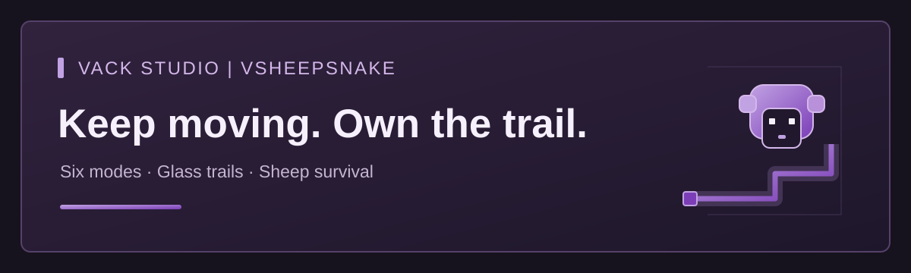

# VSheepSnake

## English

**A sheep-trail survival minigame by Vack Studio.** Ride an automatically moving sheep, steer by looking, and avoid glass trails, other sheep and the arena boundary.

### Features

- Six modes: **Classic, Turbo, Shrinking, Teams, Decay and Sudden Death**.
- Deterministic grid collisions with tick-based, fractional movement.
- Separate arena queues, lobbies, countdowns and spectators.
- Manual static arenas, plus optional isolated template worlds through VackWorlds.
- Wool/trail colors and auras, cosmetic previews, premium permission checks and transactional purchases.
- Persistent statistics, earned coins, achievements and XP progression.
- English in-game interfaces with the Vack Studio visual palette.

### Requirements

- **Minecraft / Paper 26.2 and Java 25**. Validation uses Paper build **130**.
- Static arenas do not require a world-provider plugin.
- Optional template mode requires **VackWorlds 1.1.0-preview.1** and **WorldEdit 7.4.6**, installed separately.
- Folia support is not claimed. Leaf, VackMini and Bedrock compatibility have not been verified.

### Verification status

Current version: **1.0.0-preview.1**. The Java build and **56 automated tests** pass. Isolated Paper probes passed **10 assertions without the optional provider** and **20 with VackWorlds and WorldEdit**, including isolated leases and cleanup. No player clients participated: mounted camera smoothness, multiplayer rounds, GUI/client behavior and player reconnect/restoration still require acceptance testing. No production performance gain is claimed.

### License and availability

**Proprietary — All rights reserved.** This information page contains the project description and original banner. Plugin source and installable artifacts are distributed privately. See [LICENSE](LICENSE) for the project's declared license notice.

---

## العربية

**لعبة بقاء تعتمد على مسارات الخراف من Vack Studio.** اركب خروفًا يتحرك تلقائيًا، ووجّهه بالنظر، وتجنب المسارات الزجاجية والخراف الأخرى وحدود الساحة.

### المزايا

- ستة أنماط: **Classic «الكلاسيكي»، Turbo «السريع»، Shrinking «الساحة المتقلصة»، Teams «الفرق»، Decay «المسارات المتلاشية»، Sudden Death «الموت المفاجئ»**.
- تصادمات حتمية تعتمد على شبكة، وحركة جزئية تُحدّث كل نبضة خادم.
- طوابير منفصلة للساحات، وردهات انتظار، وعدّ تنازلي، ومشاهدة.
- ساحات ثابتة تُعدّ يدويًا، مع خيار عوالم قوالب مستقلة عبر VackWorlds.
- ألوان للصوف والمسارات وهالات تجميلية، ومعاينة للمظهر، والتحقق من صلاحية المظاهر المميزة، وعمليات شراء بمعاملات متكاملة.
- إحصاءات وعملات مكتسبة وإنجازات وتقدم بنقاط الخبرة تُحفظ باستمرار.
- واجهات داخل اللعبة باللغة الإنجليزية بألوان Vack Studio المعتمدة.

### المتطلبات

- **Minecraft / Paper 26.2 وJava 25**. أُجري التحقق باستخدام إصدار Paper رقم **130**.
- لا تتطلب الساحات الثابتة إضافة لتوفير العوالم.
- يتطلب وضع القوالب الاختياري تثبيت **VackWorlds 1.1.0-preview.1** و**WorldEdit 7.4.6** بشكل منفصل.
- لا يُدّعى دعم Folia. لم يُتحقق من التوافق مع Leaf أوVackMini أوBedrock.

### حالة التحقق

الإصدار الحالي: **1.0.0-preview.1**. نجح بناء Java و**56 اختبارًا آليًا**. نجحت اختبارات Paper المعزولة في **10 تحققات دون مزود العوالم الاختياري** و**20 تحققًا مع VackWorlds وWorldEdit**، بما يشمل تخصيص عوالم مستقلة وتنظيفها. لم يشارك أي عميل لاعب: ما زالت سلاسة كاميرا الركوب، والجولات متعددة اللاعبين، وسلوك الواجهات والعملاء، وإعادة الاتصال واستعادة حالة اللاعبين تحتاج إلى اختبارات قبول. لا يُدّعى تحقيق تحسن في أداء بيئة الإنتاج.

### الترخيص والإتاحة

**برمجية مملوكة — جميع الحقوق محفوظة.** تحتوي هذه الصفحة التعريفية على وصف المشروع ولافتته الأصلية. تُوزع الشيفرة المصدرية وملفات الإضافة القابلة للتثبيت بصورة خاصة. راجع [LICENSE](LICENSE) للاطلاع على إشعار الترخيص المعتمد للمشروع.

Copyright (c) Vack Studio. All rights reserved.
